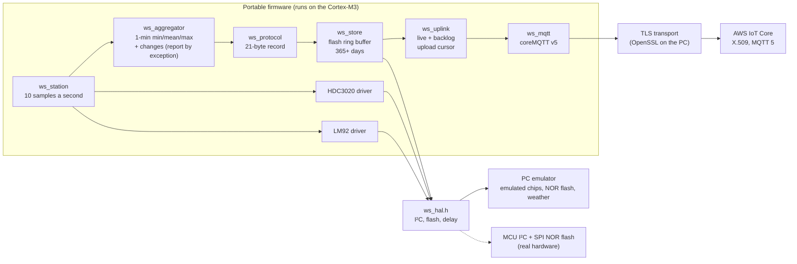

# InVivo Weather Station

Weather stations on farms measure air temperature (LM92) and relative humidity (HDC3020) with a
Cortex-M3 MCU, keep a year of history in on-board flash, and publish to AWS IoT Core within one
second. A Lambda decodes the binary payload into DynamoDB, and a React app displays it.

No hardware is used: the station is emulated on a PC by the same portable C code that would run on
the MCU, with emulated sensors, flash and clock.

## Status

| Part | Status |
|---|---|
| Binary protocol v1 ([docs/PROTOCOL.md](docs/PROTOCOL.md)) | Done |
| C encoder/decoder with tests and shared test vectors | Done |
| Sensor drivers, minute summaries and change records, PC emulator | Done |
| Flash storage with power-cut recovery | Done |
| Publishing to AWS IoT Core (MQTT 5, X.509, backlog after outages) | Done |
| Cloud ingest (IoT rule, Lambda, DynamoDB, failure queue, CDK) | Done |
| Web frontend | Not started |

## Continuous integration

[`.github/workflows/ci.yml`](.github/workflows/ci.yml) runs the firmware tests and the cloud tests on
every push and pull request.

## Firmware: build and test

Requires CMake ≥ 3.20 and gcc or clang.

```sh
cmake -S firmware -B build
cmake --build build
ctest --test-dir build --output-on-failure
```

Tests run under AddressSanitizer and UndefinedBehaviorSanitizer, with every compiler warning
treated as an error.

## Emulator

Runs the real firmware against emulated sensors on an emulated I²C bus, faster than real time.

```sh
./build/ws-emulator                         # a normal autumn day, with a rain shower at 13:00
./build/ws-emulator --scenario frost        # a frost night: sub-zero minimums
./build/ws-emulator --temp-offset -2        # a colder spot: 2 °C lower, more humid
./build/ws-emulator --shower-at 09:30        # move the rain shower (UTC), e.g. into a live demo
./build/ws-emulator --i2c-errors 0.05 --crc-errors 0.02   # a faulty sensor bus
./build/ws-emulator --hours 1 --hex         # also print each MQTT payload in hex

# Flash persistence: cut the power mid-write, then reboot from the same flash image
./build/ws-emulator --flash station.flash --hours 1 --power-cut-after 30
./build/ws-emulator --flash station.flash --hours 1   # "torn records 1", continues at the next seq
```

```
2026-10-23T12:59:00.0Z  #780   MINUTE  T   19.94 /   20.06 /   20.19 °C   RH   51.76 /   51.84 /   51.90 %   valid 100%/100%
2026-10-23T13:00:02.6Z  #781   CHANGE  T   20.00 °C   RH   52.28 %
2026-10-23T13:00:05.3Z  #782   CHANGE  T   19.75 °C   RH   52.68 %
2026-10-23T13:00:00.0Z  #805   MINUTE  T   18.50 /   19.32 /   20.13 °C   RH   51.80 /   56.78 /   61.76 %   valid 100%/100%
```



| Path | Contents |
|---|---|
| `firmware/src`, `firmware/include` | Portable firmware code: no heap, no OS, no I/O, no floating point |
| `firmware/emu` | PC-only: emulated LM92, HDC3020 and NOR flash (with power-cut injection), weather model, `ws-emulator` |
| `firmware/test` | Unit tests, and a whole-station test over an emulated day |
| `app/` | Amplify Gen 2 app: IoT identities, ingestion; API and dashboard next |
| `tools/station-credentials.sh` | Station key pair and CSR; fetches the signed certificate |
| `firmware/tools/gen_vectors.c` | Generates `protocol/vectors-v1.json` |
| `protocol/vectors-v1.json` | Valid and malformed frames with expected decode results, shared by every decoder |

## AWS IoT Core: device identity and publishing

The cloud side is an AWS Amplify Gen 2 app in [`app/`](app/). The station identities are written as
plain CDK in [`app/amplify/iot/resource.ts`](app/amplify/iot/resource.ts):
one IoT thing and certificate per station, and one policy that lets a station connect only as its
own thing and publish only to `invivo-ws/{its id}/telemetry`.

Requires Node.js ≥ 20, an AWS profile (here `fs`, region `eu-north-1`) and OpenSSL.

```sh
# 1. Key pair + certificate signing request per station (private keys stay in certs/, gitignored)
tools/station-credentials.sh create station-001
tools/station-credentials.sh create station-002

# 2. Deploy: AWS signs each CSR and creates things, certificates and the policy
cd app && npm install && npx ampx sandbox --once --profile fs && cd ..

# 3. Fetch the signed certificates and the account's IoT endpoint
tools/station-credentials.sh fetch station-001
tools/station-credentials.sh fetch station-002
```

Then run the emulated station against AWS IoT Core:

```sh
# The policy refuses another station's topic (MQTT 5 reason 0x87), and allows the station's own
./build/ws-emulator --mqtt station-001 --authz-check station-002

# 10 emulated minutes at 30x speed, with the signal lost from minute 3 to minute 6
./build/ws-emulator --mqtt station-001 --speed 30 --hours 0.1667 --outage 3:3 --flash online.flash
```

```
    PUBACK #3 (live)   30 ms
--- link down: simulated loss of signal ---
2026-10-23T18:46:00.0Z  #4     MINUTE  T   17.75 /   17.84 /   17.94 °C   ...
--- connected to a3kt48ho2auteh-ats.iot.eu-north-1.amazonaws.com as station-001 (TLS + MQTT 224 ms) ---
    PUBACK #4-#6 (backfill, 3 records)   28 ms
    PUBACK #7 (live)   32 ms
uplink: delivered through #10 of #10 (all)
PUBACK round trip over 8 publishes: median 28 ms, p95 30 ms, max 32 ms
```

## Cloud

`app/amplify/`: IoT rule → ingest Lambda → DynamoDB (`ingest/`).

```sh
cd app && npm test
npx ampx sandbox --once --profile fs
```

Remove everything again with `cd app && npx ampx sandbox delete --profile fs`.

Copyright © 2026 Khanh Pham. All rights reserved.
