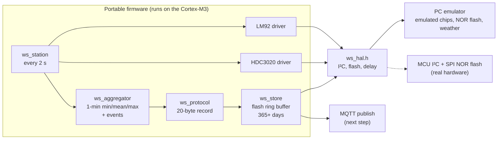

# InVivo Weather Station

Weather stations on farms measure air temperature (LM92) and relative humidity (HDC3020) with a
Cortex-M3 MCU, keep a year of history in on-board flash, and publish to AWS IoT Core within one
second. A Lambda decodes the binary payload into DynamoDB, and a React app displays it.

No hardware is used: the station is emulated on a PC by the same portable C code that would run on
the MCU, with emulated sensors, flash and clock.

## Status

| Part | Status |
|---|---|
| Binary protocol v1 ([docs/PROTOCOL.md](docs/PROTOCOL.md)) | Done |
| C encoder/decoder with tests and shared test vectors | Done |
| Sensor drivers, aggregation and events, PC emulator | Done |
| Flash storage with power-cut recovery | Done |
| Publishing to AWS IoT Core | Not started |
| Cloud ingest (Lambda, DynamoDB, IaC) | Not started |
| Web frontend | Not started |

## Firmware: build and test

Requires CMake ≥ 3.20 and gcc or clang.

```sh
cmake -S firmware -B build
cmake --build build
ctest --test-dir build --output-on-failure
```

Tests run under AddressSanitizer and UndefinedBehaviorSanitizer, with every compiler warning
treated as an error.

## Emulator

Runs the real firmware against emulated sensors on an emulated I²C bus, faster than real time.

```sh
./build/ws-emulator                         # a normal autumn day, with a rain shower at 13:00
./build/ws-emulator --scenario frost        # a frost night: frost and thaw events
./build/ws-emulator --i2c-errors 0.05 --crc-errors 0.02   # a faulty sensor bus
./build/ws-emulator --hours 1 --hex         # also print each MQTT payload in hex

# Flash persistence: cut the power mid-write, then reboot from the same flash image
./build/ws-emulator --flash station.flash --hours 1 --power-cut-after 30
./build/ws-emulator --flash station.flash --hours 1   # "torn records 1", continues at the next seq
```

```
2026-10-23T12:59:00Z  #780   AGG    T   19.94 /   20.05 /   20.13 °C   RH   51.51 /   51.88 /   52.18 %   n 30/30
2026-10-23T13:00:34Z  #781   EVENT  T   19.25 °C   RH   57.88 %
2026-10-23T13:00:00Z  #782   AGG    T   18.63 /   19.34 /   20.06 °C   RH   51.17 /   56.66 /   61.49 %   n 30/30
```



| Path | Contents |
|---|---|
| `firmware/src`, `firmware/include` | Portable firmware code: no heap, no OS, no I/O, no floating point |
| `firmware/emu` | PC-only: emulated LM92, HDC3020 and NOR flash (with power-cut injection), weather model, `ws-emulator` |
| `firmware/test` | Unit tests, and a whole-station test over an emulated day |
| `firmware/tools/gen_vectors.c` | Generates `protocol/vectors-v1.json` |
| `protocol/vectors-v1.json` | Valid and malformed frames with expected decode results, shared by every decoder |

Copyright © 2026 Khanh Pham. All rights reserved.
